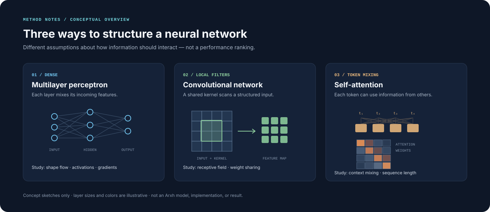
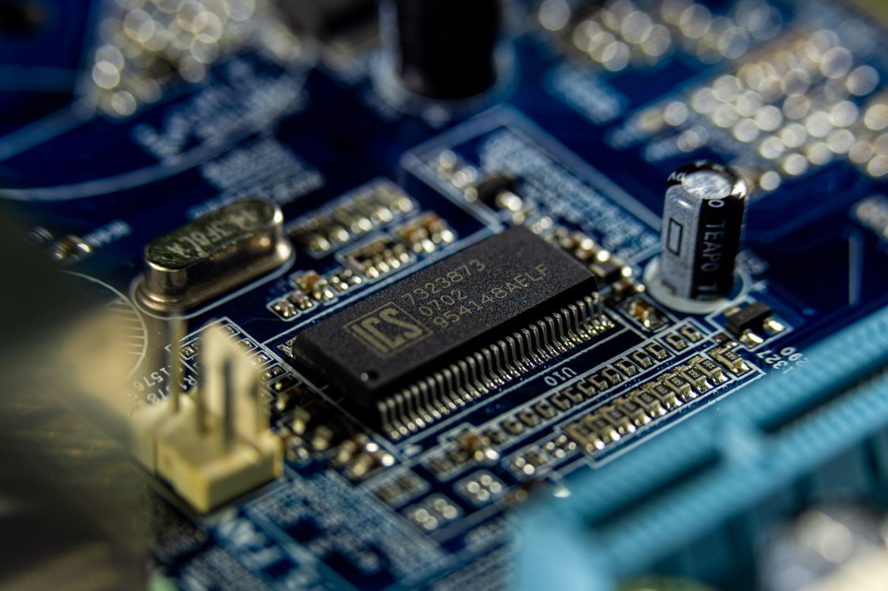

  
  
<strong>Deep learning, explored with Rust. Learning in public.</strong>

# Arxh

Arxh is an early-stage research and learning project exploring machine learning—especially neural-network methods—with Rust. The goal is to understand the methods, study the available Rust tooling, and design small investigations whose claims could eventually be checked and repeated. This repository is a research plan and a place to record questions, sources, and limitations; it is not a finished ML product.

> **Status, stated plainly:** this checkout has no `Cargo.toml`, Rust ML implementation, model, experiment runner, trained weights, or measured Rust ML result. The founder reports that there is currently no budget to build or train a model. This is a user-reported project constraint; no compute access, spending, training run, or benchmark is assumed here. The two-month agenda below is a **proposed eight-week plan**, not a record of completed research.

## Contents

- [Research question and scope](#research-question-and-scope)
- [What the literature suggests we should study](#what-the-literature-suggests-we-should-study)
- [Rust ML ecosystem: candidates, not selections](#rust-ml-ecosystem-candidates-not-selections)
- [Proposed eight-week research plan](RESEARCH-PLAN.md)
- [Research protocol and evidence standards](#research-protocol-and-evidence-standards)
- [Technical visuals and image credits](#technical-visuals-and-image-credits)
- [What is in this repository](#what-is-in-this-repository)
- [Contributing](CONTRIBUTING.md)
- [References](#references)
- [License](#license)

## Research question and scope

The initial question is practical and deliberately limited: **what would it take to describe, implement, and evaluate one small neural-network task in Rust with enough detail that another person could check the result?** This is not a claim that Rust is faster, safer for every ML workload, or a replacement for established ML ecosystems. Those claims require measurements and a clearly defined comparison, neither of which exists in this repository today.

The proposed investigation is organized around three questions:

1. **Methods:** What are the essential computations and assumptions behind a small multilayer perceptron (MLP), a convolutional neural network (CNN), and an attention-based model? Which one is the smallest sensible teaching experiment?
2. **Rust workflow:** What do current Rust ML frameworks expose for tensors, automatic differentiation, model definition, optimization, data handling, inference, and CPU execution? What dependencies and setup work do their own documentation require?
3. **Evidence under a resource constraint:** What minimum protocol would let us report correctness, repeatability, runtime, and limitations without pretending that one small run establishes a general language or framework ranking?

This scope prioritizes careful reading, a framework comparison based on primary documentation, and a reproducible experiment specification. The plan does not promise to train a model. If appropriate no-cost compute is not already available, the eight-week outcome should be a documented study design and a clear feasibility decision—not fabricated results or unapproved spending.

## What the literature suggests we should study

The initial reading list is a scoping pass, not a systematic review. It starts with foundational work and official project documentation, then asks what each source contributes to a modest Rust-based study.

- **Backpropagation and the MLP.** Rumelhart, Hinton, and Williams describe repeatedly adjusting network weights to reduce a discrepancy between actual and desired outputs [1](https://www.nature.com/articles/323533a0). For a first implementation, the useful learning target is the complete chain—input representation, affine layers, nonlinearities, loss, gradient calculation, and an update—not merely a diagram of connected nodes. The paper is historically important; it is not a claim that Arxh has implemented or validated backpropagation.
- **Initialization and optimization.** Glorot and Bengio study why deep feed-forward networks can be difficult to train, including how activations and gradients behave across layers [2](https://proceedings.mlr.press/v9/glorot10a.html). This motivates tracking initialization and training settings explicitly rather than treating a model architecture as the whole method. Their findings do not establish that one initializer or activation is best for every task.
- **Convolutional networks.** LeCun and colleagues describe gradient-based learning for document recognition and convolutional networks [3](https://doi.org/10.1109/5.726791). A CNN is a useful methods topic because spatial structure and local, shared filters change the computation relative to a fully connected MLP. A future experiment would need a task whose input structure makes that inductive bias relevant.
- **Residual learning.** He and colleagues present a residual learning framework for training substantially deeper visual-recognition networks [4](https://openaccess.thecvf.com/content_cvpr_2016/html/He_Deep_Residual_Learning_CVPR_2016_paper.html). This is useful background for understanding skip connections, but a deep residual model is not an appropriate first resource-constrained implementation by default.
- **Attention and Transformers.** Vaswani and colleagues propose an encoder–decoder architecture based on attention rather than recurrence or convolution for their sequence-transduction experiments [5](https://arxiv.org/abs/1706.03762). The paper’s experimental setup also reminds us that a method’s conceptual simplicity does not imply that its training is cheap. Attention is in the reading scope, not a promise to train a Transformer.

The online textbook *Deep Learning* by Goodfellow, Bengio, and Courville provides a broader foundation across linear algebra, numerical computation, feed-forward networks, optimization, convolution, and methodology [6](https://www.deeplearningbook.org/). These readings define questions to investigate; they do not constitute a literature review of every current architecture or a result produced by Arxh.

  
  
Original vector schematic for orientation. Method details and citations are listed above and in the research plan; this is not model output.

## Rust ML ecosystem: candidates, not selections

The project pages below are starting points for a documented comparison. Their descriptions are the projects’ own; Arxh has not installed, tested, benchmarked, or selected them.

| Candidate | What its own documentation describes | Question for the proposed review |
|---|---|---|
| [Burn](https://burn.dev/docs/burn/) | A Rust deep-learning framework covering tensors, autodiff, neural-network modules, optimizers, training, and model storage; its documentation lists selectable backends [7](https://github.com/tracel-ai/burn). | Which minimal CPU backend and feature set give a small example with transparent dependencies? |
| [Candle](https://github.com/huggingface/candle) | A minimalist ML framework for Rust with tensor and model examples [8](https://github.com/huggingface/candle). | Which operations and training components are supplied directly, and what must a small study implement itself? |
| [`tch-rs`](https://github.com/LaurentMazare/tch-rs) | Rust bindings to the C++ API of PyTorch [9](https://github.com/LaurentMazare/tch-rs). | What does a binding approach make convenient, and what external LibTorch version and build setup does it require? |
| [Linfa](https://rust-ml.github.io/linfa/rustdocs/linfa/) | A Rust toolkit centered on preprocessing and classical ML algorithms [10](https://rust-ml.github.io/linfa/rustdocs/linfa/). | Could a classical baseline provide a useful point of reference without being confused with a deep-learning framework? |
| [SmartCore](https://github.com/smartcorelib/smartcore) | A Rust library for machine learning and numerical computing, including classical methods [11](https://github.com/smartcorelib/smartcore). | Which baseline is simple enough to explain and verify for a chosen task? |

The comparison should record the date checked, documentation version or repository revision, declared features, CPU path, dependencies, example quality, data-loading assumptions, and any environment requirements. The ecosystem changes quickly, so this table is a reading map, not a compatibility guarantee. No package is the project’s “winner” before an experiment and a stated selection criterion exist.

## Proposed eight-week research plan

The detailed [research plan](RESEARCH-PLAN.md) structures the next two months as four two-week phases: foundations and method reading; framework reconnaissance; dataset, baseline, and protocol design; and a final synthesis with a resource-feasibility decision. Each week has a planned output and an exit criterion. The schedule is forward-looking. It must not be read as evidence that the review, implementation, or any experiment has already happened.

  
  
Proposed method only. The current repository has no Rust ML implementation or benchmark result.

An experiment should pass a resource gate before anyone builds or trains a model: confirm that an appropriate existing machine and permitted software are available at no cost; identify the dataset and its license; define the split, baseline, metric, random seeds, and correctness checks; and record the precise dependencies and commands. If the gate fails, keep the deliverable at the level of literature notes and an experiment specification. Do not infer access to a GPU or a cloud account from the subject matter of the project.

## Research protocol and evidence standards

Any future experiment proposal should begin with one testable question, a task definition, and a result that could falsify the working expectation. The protocol should state the data source, terms, preprocessing, split, model and parameter count where practical, initialization, optimizer, loss, hyperparameters, seeds, software versions, hardware, and exact run command. If the experiment is not run, these fields remain a plan rather than being filled with invented values.

Correctness is checked before speed. For a classification example, that could include tensor-shape assertions, a tiny hand-checkable forward pass, stable loss behavior on a controlled input, and confirmation that evaluation uses the declared hold-out split. Runtime should be measured only after the output is correct, with the measurement boundary and warm-up policy stated. Repeated runs, error bars, and all relevant failures should be reported when feasible; a single run is a case study, not a stable estimate. A performance comparison is not meaningful when workloads, hardware, library versions, data movement, or timing boundaries differ without disclosure.

The project will treat provenance and reproducibility as part of the method. Dataset and software versions should be identified, and externally sourced assets should keep their creators, source pages, and terms with them. The NeurIPS checklist provides prompts for experiment reproducibility, code and data access, compute disclosure, and asset attribution [12](https://neurips.cc/Conferences/2021/PaperInformation/PaperChecklist). MLPerf Tiny’s rules are a useful separate reference for benchmark consistency and reproducibility [13](https://github.com/mlcommons/tiny/blob/master/benchmark/MLPerfTiny_Rules.adoc); Arxh is not an MLPerf participant, and this project does not claim compliance with that benchmark.

## Technical visuals and image credits

The visual direction is intentionally technical rather than generic: two real macro photographs of circuit-board components, plus original SVG schematics of neural-network methods and a proposed research process. The photographs are source-verified stock photos rather than image-generation-model output; the diagrams are direct vector schematics, not generated photos. The selected photographs contain no visible people or faces. There is no data-center image, staged portrait, or fabricated code screen in the gallery. The hardware photos are illustrative only; they are not Arxh equipment and do not show compute used for a result.

  
  
  
Photographs by <a href="https://www.pexels.com/@sejio402/">Sergei Starostin</a> and <a href="https://www.pexels.com/@iohichu/">Ivan Chumak</a> on Pexels. Hardware context only—not Arxh compute. See the <a href="assets/README.md">asset register</a> for source pages and license notes.

The full [asset register](assets/README.md) records each photographer, original Pexels page, license, local image size, and intended use. Pexels describes the photos as free to use under its license, allows modifications, and says attribution is appreciated but not required; this is not the same as public-domain status. The hand-authored diagrams are conceptual, not copied paper figures, and are labeled as schematics rather than evidence.

## What is in this repository

- `README.md` — project status, research scope, initial literature map, and method overview.
- [`RESEARCH-PLAN.md`](RESEARCH-PLAN.md) — proposed eight-week/two-month agenda, study questions, feasibility gate, and planned deliverables.
- [`assets/`](assets/README.md) — documented image credits, licenses, and original SVG diagrams.
- [`CONTRIBUTING.md`](CONTRIBUTING.md) — contribution and evidence expectations.
- [`tests/`](tests/README.md) — a separate, exploratory 30-scenario suite from an earlier general AI-agent evaluation direction.

The 30 scenarios cover general research, file work, coding, multimodal tasks, and computer use. They have no recorded results and are not a Rust ML experiment, deep-learning benchmark, or validated agent score. They remain clearly separated from the research plan; changing or documenting them does not count as model work.

## References

1. Rumelhart, Hinton, and Williams, “Learning representations by back-propagating errors,” *Nature* (1986): [1](https://www.nature.com/articles/323533a0).
2. Glorot and Bengio, “Understanding the difficulty of training deep feedforward neural networks,” PMLR (2010): [2](https://proceedings.mlr.press/v9/glorot10a.html).
3. LeCun et al., “Gradient-Based Learning Applied to Document Recognition,” *Proceedings of the IEEE* (1998): [3](https://doi.org/10.1109/5.726791).
4. He et al., “Deep Residual Learning for Image Recognition,” CVPR (2016): [4](https://openaccess.thecvf.com/content_cvpr_2016/html/He_Deep_Residual_Learning_CVPR_2016_paper.html).
5. Vaswani et al., “Attention Is All You Need,” arXiv:1706.03762 (2017): [5](https://arxiv.org/abs/1706.03762).
6. Goodfellow, Bengio, and Courville, *Deep Learning*, MIT Press (2016): [6](https://www.deeplearningbook.org/).
7. Burn documentation and repository: [7](https://github.com/tracel-ai/burn).
8. Candle repository: [8](https://github.com/huggingface/candle).
9. `tch-rs` repository: [9](https://github.com/LaurentMazare/tch-rs).
10. Linfa documentation: [10](https://rust-ml.github.io/linfa/rustdocs/linfa/).
11. SmartCore repository: [11](https://github.com/smartcorelib/smartcore).
12. NeurIPS 2021 Paper Checklist Guidelines: [12](https://neurips.cc/Conferences/2021/PaperInformation/PaperChecklist).
13. MLPerf Tiny inference rules: [13](https://github.com/mlcommons/tiny/blob/master/benchmark/MLPerfTiny_Rules.adoc).

The source pages above were consulted as an initial literature and documentation scan on 22 November 2026. This is not a systematic review, compatibility test, or independent audit of the projects.

## License

There is currently no `LICENSE` file in this repository. Do not assume that the repository’s text, diagrams, or source code have been granted an open-source reuse license. The Pexels photographs have their own stated Pexels terms; those terms do not license the rest of the repository. Please check the [asset register](assets/README.md) and applicable source terms before reusing any material.
