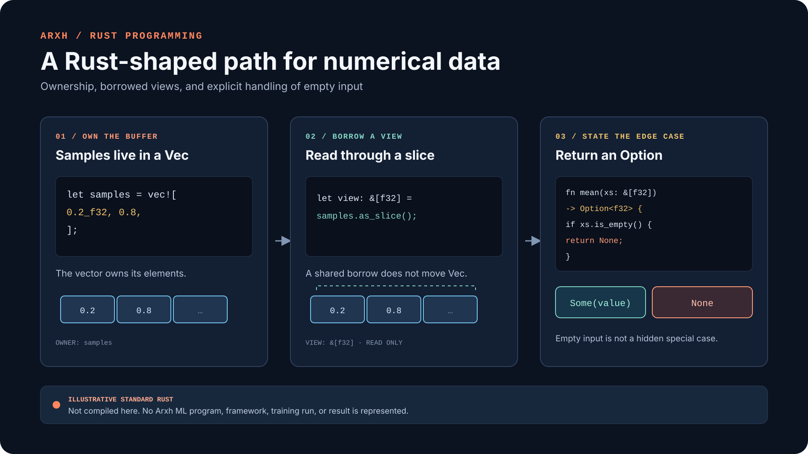
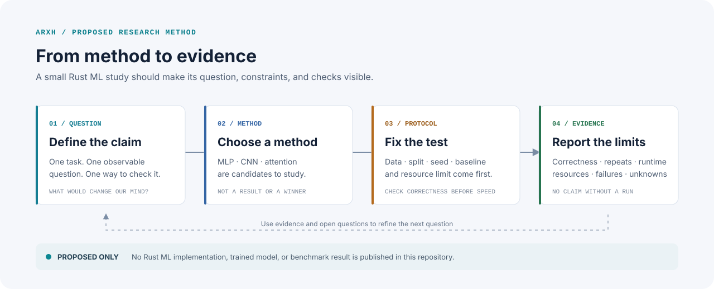
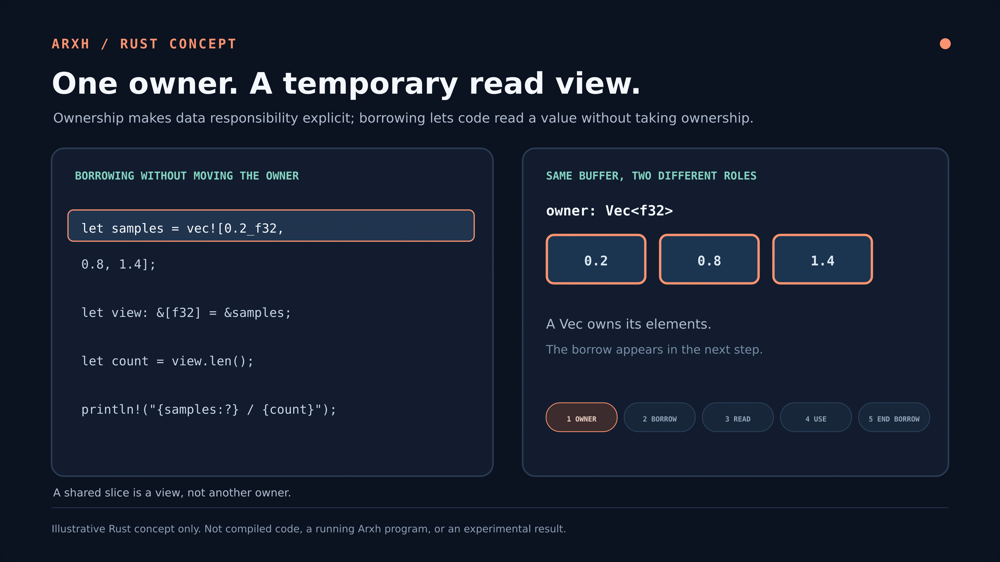
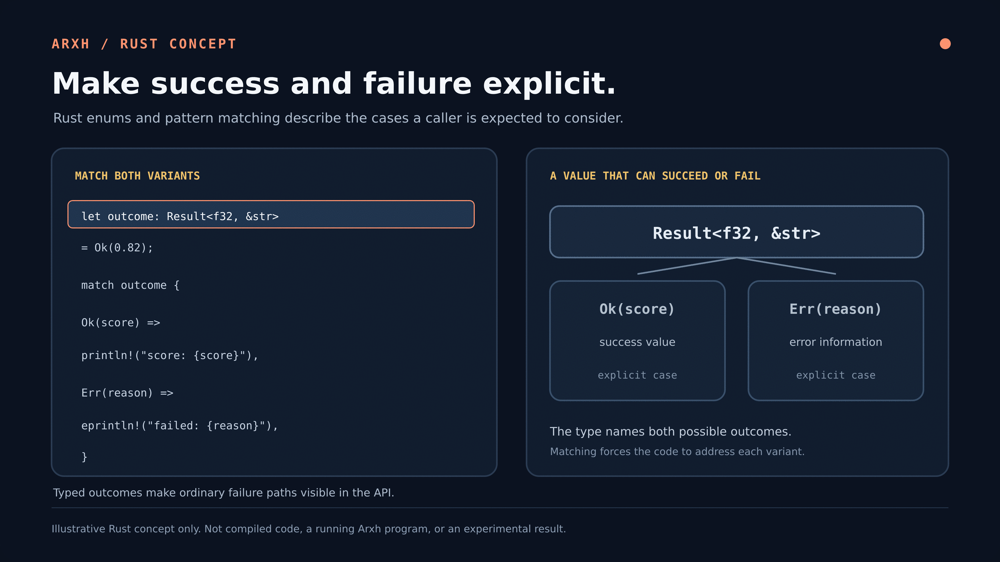
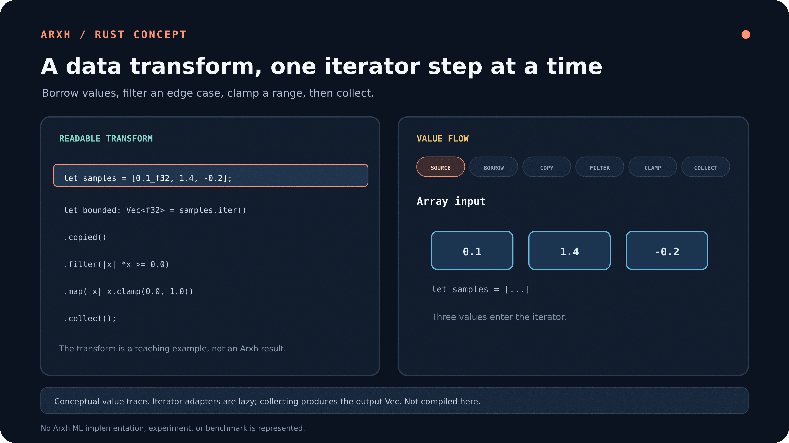

  
  
<strong>Learning Rust. Exploring machine learning. Sharing the questions before the claims.</strong>

# Arxh

Arxh is an early-stage learning and research project exploring machine learning with Rust. It brings two subjects together: how to write clear, maintainable Rust, and how to reason carefully about the methods and software that make machine learning work. The project is being developed in public, with an emphasis on useful questions, traceable sources, and honest limits rather than premature performance claims.

> **Current status, checked 22 November 2026:** this repository has no `Cargo.toml`, Rust ML implementation, model, training code, trained weights, or measured ML result. The founder reports that there is currently no budget to build or train a model. This README describes a learning direction and proposed research process. It does not imply access to a GPU, cloud compute, paid services, or an experimental result. The code-shaped examples and diagrams are illustrative. They have not been compiled or run in this checkout.

## Contents

- [Purpose and boundaries](#purpose-and-boundaries)
- [Why study machine learning through Rust?](#why-study-machine-learning-through-rust)
- [Rust foundations for numerical software](#rust-foundations-for-numerical-software)
- [Learning Rust: a practical route](#learning-rust-a-practical-route)
- [The Rust machine-learning landscape](#the-rust-machine-learning-landscape)
- [Methods worth understanding](#methods-worth-understanding)
- [A proposed study, not a completed experiment](#a-proposed-study-not-a-completed-experiment)
- [Short visual walkthroughs](#short-visual-walkthroughs)
- [Selected external video talks](#selected-external-video-talks)
- [What this repository contains](#what-this-repository-contains)
- [Research and evidence standards](#research-and-evidence-standards)
- [References and learning resources](#references-and-learning-resources)
- [License and reuse](#license-and-reuse)

## Purpose and boundaries

The starting question is deliberately modest: **what would it take to explain and evaluate one small machine-learning task using Rust in a way that another person could inspect and repeat?** Answering that requires more than selecting a framework. It means understanding the task, its data, the mathematical method, the Rust toolchain, the chosen dependencies, and the tests that would make a result credible.

The project is not claiming that Rust is automatically faster than Python, that every ML workload should be written in Rust, or that Rust removes the need for numerical validation. Those statements depend on workload, implementation, hardware, libraries, data movement, and measurement. No comparison of that kind has been conducted here. The intent is to learn what Rust makes easier to express, what it makes harder, and where a Rust-based approach may be useful.

A second boundary is resources. The founder has said there is no current budget for building or training a model. Therefore, the plan begins with reading, language practice, and documentation review. Any future build or training work must pass a resource and permission check first. If suitable no-cost resources are not already available, an honest research note or experiment specification is a valid outcome. No paid service, hardware purchase, or training run is assumed.

This repository also contains an earlier set of 30 general AI-agent evaluation scenarios. Those scenarios are a separate workstream. They are not an ML dataset, Rust framework evaluation, neural-network experiment, or result for this research direction. Their status and purpose are described separately below.

## Why study machine learning through Rust?

Machine learning is often introduced through Python because its scientific ecosystem makes experimentation convenient. Rust offers a different learning surface. It asks the programmer to be explicit about ownership and borrowing, types, errors, dependencies, and the boundaries between components. Those properties make Rust interesting both as a language to learn and as a place to investigate systems-level ML infrastructure.

This is not a contest between languages. A useful future system might combine languages, calling Rust libraries from another application or using existing model formats. A practical study should compare a complete workflow, not a language label. The question might concern data preparation, inference, model implementation, or deployment, and each choice has different constraints. Arxh has not selected one of those paths yet.

Rust can make some categories of mistakes more visible during development. Ownership and borrowing rules constrain how references to data may be used. Static types can describe the shape of an API, and enums can represent alternatives such as success and failure. Cargo gives a consistent place to declare dependencies and commands. These are helpful design tools, not proofs that the mathematics, data, or conclusions are correct.

The most productive reason to explore Rust here is educational: implementing or reading a small numerical method can connect language concepts to a concrete problem. A slice can make a read-only view clear. A `Result` can make failure handling part of a function's signature. Traits can allow a component to work with different implementations. Tests can pin down a known calculation. Those connections give the project a useful learning agenda even before there is an ML application.

## Rust foundations for numerical software

A machine-learning workflow manipulates data repeatedly. In Rust, it helps to understand how data is owned, borrowed, transformed, and passed between functions before adding a tensor library or accelerator backend.

- **Ownership and borrowing:** a `Vec<T>` owns a growable collection. A slice such as `&[f32]` is a view over values owned elsewhere. Shared references are read-only, while mutable access has stricter exclusivity rules. Lifetimes describe how long references remain valid. These rules can help clarify data flow, but they do not tell us whether a dataset is representative or a calculation is scientifically sound.
- **Types, structs, and enums:** types make interfaces visible. A struct can hold related configuration. An enum can describe a finite set of cases. `Option<T>` represents a value that might be absent, while `Result<T, E>` represents a value that might be produced or an error that might need handling. Pattern matching makes the cases explicit in code.
- **Traits and generics:** traits define behavior that different types can implement. Generic code can express reusable abstractions without tying every component to one concrete type. ML libraries use these mechanisms for tensor operations, devices, data loaders, and backends. The details differ by library, so reading the public API matters more than assuming frameworks use the same design.
- **Iterators and numerical data:** Rust iterators provide a way to transform sequences with clear ownership rules. Numerical work still needs attention to precision, layout, shapes, overflow, and performance. An iterator chain is not automatically faster or more memory efficient than another implementation; inspect and measure the workload if performance becomes a research question.
- **Concurrency:** Rust's type system and safe APIs can help prevent some classes of data races when sharing data across threads. Concurrent code can still be logically incorrect, nondeterministic, or slower than sequential code. Threading, GPU kernels, and asynchronous execution introduce distinct concerns that should be learned from the relevant library documentation.
- **Cargo and the compiler:** Cargo manages a Rust package, dependencies, build commands, and tests. `rustc` compiles Rust code, and Cargo normally invokes it for a project. Build success, where available, only checks that code passes the compiler's rules. It does not validate an ML claim.

  
  
Original 1920 by 1080 vector schematic. The snippets illustrate standard Rust concepts and are not a compiled Arxh program.

The schematic uses a numerical buffer only to make the language concepts concrete. It is not a framework tutorial, model architecture, or benchmark. An eventual learning exercise could expand from these basics to parsing a small dataset, validating its shape, calculating a known quantity, and writing tests for edge cases. Such an exercise would remain a language and methods exercise until its task and evidence were defined.

### Questions that keep the Rust focus practical

When reading a Rust ML library, start with what a newcomer can inspect directly. How is a minimal crate created? Which types represent tensors and dimensions? How are values moved between host memory and an accelerator? What happens when an operation fails? Can the example be tested without downloading a large model? Are dependencies and features stated clearly? Which code is safe Rust, and where does the library rely on unsafe internals?

These questions avoid treating a framework name as a result. They also help distinguish the experience of using Rust from the performance of a particular kernel. A program could use Rust for data loading and orchestration while relying on an existing backend for numerical operations. Another project could implement kernels directly. Those are different engineering choices, and neither can be evaluated from a language slogan.

## Learning Rust: a practical route

Readers who are new to Rust can follow the official learning path rather than beginning with an ML framework. The [Rust learning page](https://www.rust-lang.org/learn) links to the main book, Rust by Example, Rustlings, the standard library, the Cargo Book, the compiler book, and other references. The sequence below is a suggested route for this project, not a prerequisite checklist or a record of completed work.

1. Read enough of [The Rust Programming Language](https://doc.rust-lang.org/book/) to understand variables, ownership, borrowing, structs, enums, error handling, generics, and tests. Work through examples rather than memorizing definitions. The official book changes over time, so consult the current online edition rather than relying on a version number copied into this README.
2. Use [Rust by Example](https://doc.rust-lang.org/rust-by-example/) to see short examples of syntax and standard library patterns. Use [Rustlings](https://github.com/rust-lang/rustlings/) if hands-on exercises and compiler feedback are a better fit. These are complementary resources, not Arxh-created courses.
3. Read the [Cargo Book](https://doc.rust-lang.org/cargo/) and the [rustc Book](https://doc.rust-lang.org/rustc/) to understand package structure, commands, compiler behavior, and build configuration. For a real project, record the toolchain and dependency versions rather than treating a command shown in a diagram as if it had already been run.
4. Practice with a small data transformation that has known inputs and outputs. Give functions clear types, handle empty or invalid input deliberately, and test the ordinary and edge cases. The purpose is to build fluency with the language, not to claim a machine-learning result.
5. Only then compare the framework examples listed below. Record what each example actually demonstrates, what it omits, and what it requires from the environment. Keep the comparison anchored to a particular question, such as model inference on CPU, rather than trying to rank every Rust ML project at once.

At the time this README was prepared, `rustc` and `cargo` were not installed in the documentation workspace, and this repository did not contain a Cargo manifest. Accordingly, no Rust example in the README is presented as compiled, tested, or run. A future code contribution should identify the toolchain used and include its own appropriate checks.

## The Rust machine-learning landscape

Rust's ML ecosystem contains projects with different goals. Some provide neural-network training abstractions. Some focus on tensor operations or inference. Others target classical algorithms or interoperate with an existing library. The table is a **candidate reading list**, not an Arxh endorsement, selection, installation report, compatibility guarantee, or benchmark.

| Candidate | What its project documentation presents | Useful question for a future review |
|---|---|---|
| [Burn](https://burn.dev/docs/burn/) | A Rust deep-learning framework with tensors, automatic differentiation, neural-network building blocks, optimizers, training tools, and multiple backend options. | What is the smallest documented CPU example, and which pieces are required for a reproducible learning task? |
| [Candle](https://github.com/huggingface/candle) | A Rust ML framework with tensor APIs and model examples, maintained in the Hugging Face ecosystem. | What is available for inference and training, and which examples can be followed without a large download or accelerator? |
| [`tch-rs`](https://github.com/LaurentMazare/tch-rs) | Rust bindings for the C++ API of PyTorch. | Which Rust interface is exposed, and what LibTorch version, native dependency, and build setup does a small program require? |
| [Linfa](https://rust-ml.github.io/linfa/rustdocs/linfa/) | A toolkit for classical machine-learning algorithms and related data workflows in Rust. | Could a simple classical baseline answer a learning question without requiring a neural-network training stack? |
| [SmartCore](https://github.com/smartcorelib/smartcore) | A Rust machine-learning and numerical-computing library with classical methods among its offerings. | Which documented method has transparent inputs, outputs, and tests suitable for a small baseline? |

The questions are intentionally more specific than “which framework is best?” A fair comparison must first choose a task and a feature set. It should then record the documentation or repository revision reviewed, the Rust toolchain, enabled features, dependencies, hardware assumptions, data-loading path, and whether the example covers training or only inference. It should also distinguish what the framework supplies from what the example author implements.

No framework has been installed, exercised, or selected for Arxh. The ecosystem evolves quickly, so a comparison written later should revisit primary documentation and record when it was checked. A package's README can demonstrate a use case, but it does not substitute for a test that answers the project's own question.

### Reading framework claims carefully

A project can be useful without being the right choice for a first study. A framework may have a compelling GPU story but require hardware that is unavailable. A binding may offer access to mature operations but make native setup more involved. A lightweight inference library may not include the training workflow a reader expects. These are possible trade-offs to investigate, not findings about a package that Arxh has tested.

For each candidate, an eventual review can ask whether a clean example builds with documented commands, whether expected output can be independently checked, whether the data pipeline is visible, and whether versions can be pinned. Notes should separate project documentation from independently reproduced observations. This distinction prevents a tutorial, a conference demonstration, or a project's own performance chart from being mistaken for Arxh evidence.

## Methods worth understanding

The intended learning scope includes basic neural-network methods and the assumptions behind them. A method is not defined by its name alone. It includes a data representation, model structure, objective, optimization procedure, evaluation protocol, and the conditions under which its results may be interpreted.

- **Multilayer perceptrons:** a small MLP can introduce matrix operations, nonlinear activations, loss functions, gradient calculation, and parameter updates. The conceptual chain is useful for a first reading exercise because each step can be named and tested separately. Rumelhart, Hinton, and Williams describe learning representations by back-propagating errors [1]. Their paper is foundational context, not evidence that Arxh has implemented backpropagation.
- **Initialization and optimization:** learning behavior depends on how values are initialized and how updates are calculated. Glorot and Bengio examine issues that make deep feed-forward networks difficult to train [2]. Their work motivates recording these choices; it does not establish one universally best configuration.
- **Convolutional neural networks:** convolution introduces local filters and shared parameters, which can make sense when the input has spatial structure. LeCun and colleagues describe gradient-based learning for document recognition [3]. A future study would need a task for which spatial structure is relevant, plus a baseline that makes the benefit of the design interpretable.
- **Residual networks:** skip connections provide a way to learn residual functions in deeper networks. He and colleagues describe this approach for image recognition [4]. A deep model is not automatically a suitable first experiment, especially when compute, time, and evaluation resources are constrained.
- **Attention and Transformers:** Vaswani and colleagues present an attention-based sequence-to-sequence architecture [5]. Attention is now a broad family of techniques, and a paper's original task and setup should not be generalized without care. The subject is part of the reading scope, not a commitment to train a Transformer.

A useful learning exercise should choose the smallest method that can answer a clearly stated question. Complexity is not a virtue on its own. A hand-checkable calculation, a simple baseline, or a careful comparison of framework interfaces may teach more than an under-resourced attempt to reproduce a large model.

The online textbook [Deep Learning](https://www.deeplearningbook.org/) by Goodfellow, Bengio, and Courville provides broader background in linear algebra, numerical computation, optimization, neural-network methods, and research methodology [6]. This reading list is an initial map, not a systematic review of current ML research.

## A proposed study, not a completed experiment

The [eight-week research plan](RESEARCH-PLAN.md) lays out a possible sequence of learning and decision points. The plan is forward-looking. Its weeks and deliverables do not indicate that the review, implementation, or evaluation has already taken place.

A practical sequence could be:

1. **Build language context.** Learn enough Rust to read a crate, understand its types, run simple examples when a toolchain is available, and write small tests. Keep notes on ownership, error handling, and package structure.
2. **Map the ecosystem.** Compare primary documentation for a small set of candidate libraries. Record each library's stated purpose, supported workflow, CPU path, feature requirements, and any environment assumptions. Do not select a tool based only on popularity or a performance claim.
3. **Design one narrow question.** Decide whether the subject is a numerical primitive, a tiny learning task, a framework interface, or an inference workflow. Define a baseline and what result would count against the initial expectation. A task that cannot be described clearly is not ready for training.
4. **Pass a resource and permission gate.** Confirm that the required machine, dataset, software, and storage are already available and may be used for the proposed purpose. Check dataset and model terms. If a suitable no-cost environment is not available, stop at the study design rather than implying that a run occurred.
5. **Test correctness before measuring speed.** Use known inputs, small cases that can be reasoned about, and explicit checks for shapes and edge conditions. If the result is not correct, performance timing is not useful evidence.
6. **Document and decide.** Report what was reviewed or run, the exact versions and commands, the result, failures, and limitations. A no-go decision or a literature-based comparison can be a useful outcome when it is stated accurately.

The following diagram summarizes a possible workflow. It uses commands as labels for future steps; those commands have not been run for an Arxh ML project.

  
  
Original 1920 by 1080 vector diagram. Proposed workflow only. It does not depict a completed Arxh implementation or result.

If future work involves training, its protocol should specify the dataset and license, preprocessing, train and evaluation split, model configuration, initialization, optimizer, loss, hyperparameters, random seeds, software versions, hardware, and exact command. If any item is unknown, report it as unknown or leave it as a decision, rather than filling the gap with an assumption. Record failed runs and practical limits as part of the result.

Performance claims need additional care. A useful measurement defines what is timed, how data is moved, whether compilation or warm-up is included, which machine and software versions were used, and how many repeated runs were completed. Comparing different workloads or measurement boundaries can create a misleading headline. One small result would describe one setup; it would not establish a general ranking of Rust, Python, or ML frameworks.

## Short visual walkthroughs

The three animations below were authored for this README from vector shapes and code text. They are exported as 4K 3840 by 2160 GIFs so the code remains crisp when scaled to common repository display sizes. They are teaching illustrations, not screen recordings, compiled output, model traces, or AI-generated photos. Each explicitly labels its scope.

  
  
Ownership and borrowing: the vector owns the values, while a slice can provide a temporary shared view.

  
  
Enums and pattern matching: a Result communicates success or error as explicit alternatives.

  
  
Iterator adapters transform a sequence. The animation shows a conceptual value trace; Rust iterators are lazy, and the output vector is created at collection.

The visuals are intentionally narrow. Ownership is not a memory-speed guarantee, and `Result` does not prove that a numerical output is valid. They illustrate language concepts that matter when reading scientific or ML code. More information about dimensions, authorship, and reuse limits is in the [asset register](assets/README.md).

## Selected external video talks

These conference recordings are supplementary learning material about Rust and machine-learning infrastructure. They describe work by their speakers and organizations. They are not Arxh experiments, endorsements, or independent evidence for a general performance claim.

1. [Ada Hieta, “Rust for ML Infrastructure: A Case Study in Building an ONNX Runtime”](https://www.youtube.com/watch?v=c8JBduPsFlI), RustConf 2026, published by the [Rust Foundation](https://www.youtube.com/@rustfoundation), 28:47. The talk discusses an ONNX inference runtime written in Rust, its components, design choices, and lessons. It is an external case study, not an Arxh implementation or a framework recommendation.
2. [Eric Karl, “Tokio, Rayon, and the GPU: Profiling a Radiology AI Pipeline in Rust”](https://www.youtube.com/watch?v=-5eHDJJmrHc), RustConf 2026, published by the Rust Foundation, 38:22. The speaker describes a team's radiology-AI pipeline and its use of Rust tooling. Any system results or performance figures are reported by that speaker and are not reproduced or verified by Arxh.
3. [Manuel Drehwald, “When Safe Code is Fast: Scientific Computing in Rust”](https://www.youtube.com/watch?v=2Ws0ZS6EHkE), RustConf 2026, published by the Rust Foundation, 30:47. The talk covers Rust compiler work, automatic differentiation, and examples from scientific computing. It is useful context for questions about safe code and numerical software, not a benchmark run by this project.
4. [Melih Elibol, “Fearless Concurrency on the GPU”](https://www.youtube.com/watch?v=ncyHIrXFFAo), RustConf 2026, published by the Rust Foundation, 39:12. The presentation explores GPU programming abstractions in Rust and discusses an external case study. It does not imply that Arxh has GPU access or GPU code.

The official [RustConf 2026 playlist](https://www.youtube.com/playlist?list=PLCIkLZab-UIM) contains additional talks on Rust language design, compiler work, systems programming, and scientific computing. Titles and runtimes above were checked against their public Rust Foundation video pages on 22 November 2026. The recordings are linked for study; their use cases and conclusions remain attributed to their speakers.

## What this repository contains

- `README.md` describes the project, Rust learning focus, research boundaries, sources, and visual assets.
- [`RESEARCH-PLAN.md`](RESEARCH-PLAN.md) contains a proposed eight-week learning and research agenda with planned outputs and decision points.
- [`assets/README.md`](assets/README.md) is the visual asset register. It records original diagrams and animations, their dimensions, the project wordmark, and reuse limits.
- [`CONTRIBUTING.md`](CONTRIBUTING.md) describes expectations for proposed contributions and evidence.
- [`tests/`](tests/README.md) contains the separate, exploratory set of 30 general AI-agent evaluation scenarios.

Those 30 scenarios are not a Rust test suite or ML evaluation. No results are recorded here for them. They concern a different, general agent-evaluation direction and must remain distinct from any future Rust ML work. Updating this README does not change their scope or make them evidence for a model.

## Research and evidence standards

The project should separate three kinds of statement: what a source says, what a proposed design would do, and what Arxh has personally built or measured. The first needs a link and a fair summary. The second should be labeled as a proposal. The third requires a reproducible description and evidence. Mixing these categories can make an early learning project look more complete than it is.

A future technical note should state the question before describing the method. It should explain why the chosen data and baseline fit the question, what outcome could challenge the expectation, and what checks would catch an implementation mistake. Results should include negative or inconclusive outcomes where relevant. A successful compiler check or passing unit test is useful but limited evidence; it does not establish model generalization, data quality, or statistical significance.

Reproducibility includes provenance. Record data sources and terms, model or library versions, dependency lockfiles, exact commands, environment details, and any preprocessing that affects results. Attribute borrowed figures, code, and datasets. The [NeurIPS Paper Checklist](https://neurips.cc/Conferences/2021/PaperInformation/PaperChecklist) is a useful prompt list for reporting reproducibility, code and data access, compute, and assets [7]. The [MLPerf Tiny rules](https://github.com/mlcommons/tiny/blob/master/benchmark/MLPerfTiny_Rules.adoc) can inform a later discussion of consistent measurement [8]. Arxh is not participating in MLPerf and does not claim compliance with those rules.

Visuals follow the same principle. A diagram is labeled as a schematic if it is a schematic. An external photograph or recording is credited to its source and is not used to imply ownership, endorsement, or project results. The current README uses a project wordmark and original Rust-focused vector illustrations. It contains no stock hardware photographs, faces, people, data-center images, or fabricated screenshots.

## References and learning resources

### Rust documentation

- Official Rust learning hub: [rust-lang.org/learn](https://www.rust-lang.org/learn).
- *The Rust Programming Language*: [doc.rust-lang.org/book](https://doc.rust-lang.org/book/).
- Rust by Example: [doc.rust-lang.org/rust-by-example](https://doc.rust-lang.org/rust-by-example/).
- Rustlings exercises: [github.com/rust-lang/rustlings](https://github.com/rust-lang/rustlings/).
- Cargo Book: [doc.rust-lang.org/cargo](https://doc.rust-lang.org/cargo/).
- rustc Book: [doc.rust-lang.org/rustc](https://doc.rust-lang.org/rustc/).

### Background reading

1. Rumelhart, Hinton, and Williams, “Learning representations by back-propagating errors,” *Nature* (1986): [doi:10.1038/323533a0](https://www.nature.com/articles/323533a0).
2. Glorot and Bengio, “Understanding the difficulty of training deep feedforward neural networks,” PMLR (2010): [proceedings.mlr.press/v9/glorot10a](https://proceedings.mlr.press/v9/glorot10a.html).
3. LeCun et al., “Gradient-Based Learning Applied to Document Recognition,” *Proceedings of the IEEE* (1998): [doi:10.1109/5.726791](https://doi.org/10.1109/5.726791).
4. He et al., “Deep Residual Learning for Image Recognition,” CVPR (2016): [CVF Open Access](https://openaccess.thecvf.com/content_cvpr_2016/html/He_Deep_Residual_Learning_CVPR_2016_paper.html).
5. Vaswani et al., “Attention Is All You Need,” arXiv:1706.03762 (2017): [arxiv.org/abs/1706.03762](https://arxiv.org/abs/1706.03762).
6. Goodfellow, Bengio, and Courville, *Deep Learning*, MIT Press (2016): [deeplearningbook.org](https://www.deeplearningbook.org/).
7. NeurIPS 2021 Paper Checklist Guidelines: [neurips.cc/Conferences/2021/PaperInformation/PaperChecklist](https://neurips.cc/Conferences/2021/PaperInformation/PaperChecklist).
8. MLPerf Tiny inference rules: [github.com/mlcommons/tiny](https://github.com/mlcommons/tiny/blob/master/benchmark/MLPerfTiny_Rules.adoc).

This reference list is a starting point, not a complete literature review. The Rust project pages and video talks above are primary sources for how their authors describe their own work. A future comparison should record the date and revision of any source that may change.

## License and reuse

This repository currently has no `LICENSE` file. Do not assume that its prose, diagrams, animations, source files, or wordmark have been granted an open-source reuse license. The visual asset register describes the origin and intended use of each included asset, but it does not grant rights beyond those stated by the respective owner or source. Please check the relevant source terms and obtain permission where needed before reusing material.
